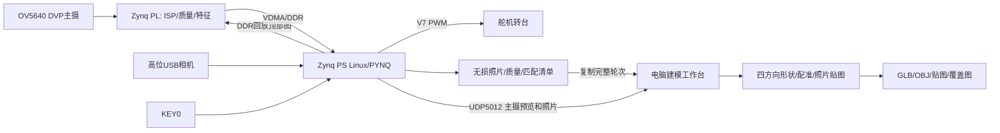

# Zynq-7020 多视角三维重构系统

基于启明星 Zynq-7020、OV5640、USB高位相机和连续旋转舵机的软硬协同建模工程。
PL采集和预处理图像，PS协调停稳拍摄及保存，电脑工作台完成分割、四视图AI形状生成、
相机配准、照片贴图与GLB/OBJ导出。形状包含AI推断，适合展示与建模实验。

## 发布基准

| 部分 | 本包版本 |
| --- | --- |
| 板端采集 | 2026-11-02 20:47已部署的18＋4版本；入口和适配器与部署记录SHA-256一致 |
| 电脑工作台 | 2026-11-03提供的fpga-modeling-workbench源码；整合包默认UDP5012 |
| FPGA设计 | 已有5MP/双路分时PL链RTL和Block Design配置；包含自编源码及构建入口 |
| 舵机 | KEY0启动18次短转，V7，1612µs运动、1500µs停止，每次580ms，停稳拍照 |
| 图像 | OV5640主摄18张，高位USB在第1、5、10、14个位置补拍4张，均2592×1944 |

软件并行取帧不等于硬件同步曝光。无角度反馈，18次计时运动不保证精确360°。
580ms版已部署和检查寄存器；它的完整轮次及重新上电恢复尚未在对应记录中验收。
上一560ms版有18＋4完整轮次记录，开机机制在更早的加速版验证过。

## 系统关系



## 目录

- `board/`：固化版Python采集程序、USB Host设备树、服务安装脚本和拍摄计划。
- `fpga/`：自编RTL、引脚约束、Block Design配置和Vivado构建脚本。
- `pc_workbench/`：最新版网页工作台、AI推理封装、照片贴图、安装和测试。
- `pc_capture/`：原协议电脑接收与诊断工具，作为独立接收入口保留。
- `tools/`：本地依赖导入、源码完整性检查及打包工具。
- `tests/`：采集分配、PNG无损保存和软件并行取帧的离线测试。
- `skill/`：可移植的通用 PYNQ Skill，含 Overlay 校验、AXI DMA 缓存同步、寄存器契约生成、黄金参考比对、Vivado 报告汇总、提示词模板与踩坑清单；不依赖本项目相机或舵机。
- `docs/`：接线、部署、构建、数据接口、验证范围和GitHub上传说明。

## 开始使用

电脑端进入`pc_workbench`，按其README运行`Install.ps1`，再双击`启动建模.cmd`。
需要Windows、Python3.11、兼容CUDA的NVIDIA显卡；权重和依赖在首次安装时下载。
COLMAP须另装并在界面/本机配置中指定路径。没有开发板时可以导入已有照片。

板端见[部署说明](docs/DEPLOYMENT.md)，自行构建PL见[构建说明](docs/FPGA_BUILD.md)。
厂家保留版权的基础IP、Vivado软件、PYNQ系统镜像和已编译位流不随源码重新分发；
可通过导入脚本从合法持有的本地工程取用，缺少这些依赖时不能直接上板。

## 数据与能力边界

- 当前UDP链发送主摄；4张顶部完整数据在板端保存，不能把电脑收到18张当成22张。
  未纳入21:04新增但缺少固化证据的TCP传输修改。
- PL执行ISP、质量统计及候选特征匹配；主体现代分割、AI形状与贴图在电脑执行。
- 两路照片支持作为输入，不代表标定双目深度融合已通过；顶部补片必须有可靠配准。
- 原图不足、遮挡和缺少纹理仍会导致几何缺损或贴图错位；不承诺实测尺寸精度。
- 不包含个人照片、人物模型、权重、运行环境、历史日志、账号凭据或大型镜像。

## 检查与贡献

```text
python tools/verify_source.py
python -m unittest discover -s tests -v
cd pc_workbench
python -m unittest discover -s tests -v
```

离线测试依赖NumPy、OpenCV、Pillow、SciPy；不控制舵机，也不验证完整GPU推理或新位流上板。
具体检查结果见[发布验证记录](docs/VALIDATION.md)。本包未创建或推送GitHub仓库。

通用 PYNQ 技能包的适用范围、逐项用法、验证结果、失效条件和来源证据见 [`skill/pynq-general/README.md`](skill/pynq-general/README.md)。其中离线 mock 测试不等同于目标开发板验证。

## 许可与第三方

本项目自编整合代码按根目录[LICENSE](LICENSE)的范围采用MIT；
`pc_workbench/vendor/`及明确标注上游来源的代码继续按各自许可，包含混元的单独条款。
本许可不覆盖厂家基础IP、模型权重、第三方商标或授权不明的材料。
详见[第三方说明](THIRD_PARTY_NOTICES.md)；保留所有上游LICENSE、NOTICE和修改记录。
